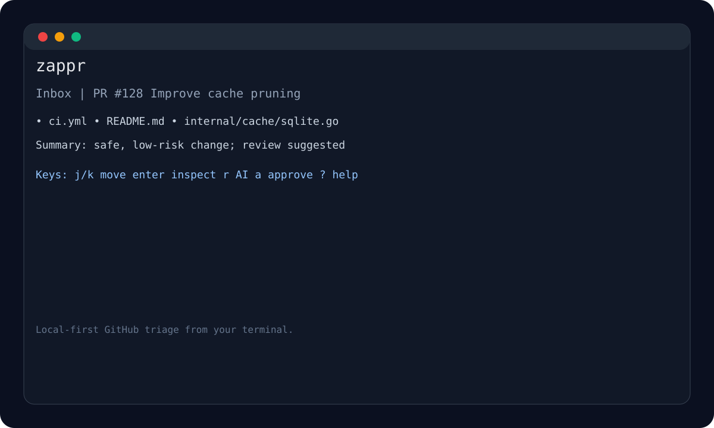

# zappr

[](https://github.com/senilio/zappr/actions/workflows/ci.yml)
[](https://go.dev/)

Terminal-first pull request inbox for fast, human-owned GitHub review triage.

zappr watches open pull requests, optionally runs shell-command AI triage on demand, and lets you inspect files, commits, PR conversation comments, diffs, comment, or approve from a keyboard-driven Bubble Tea UI.

## Principles

- Human approves; zappr only recommends.
- AI review is manual and advisory.
- Terminal-only, local-first, no SaaS.
- Fast triage over deep autonomous review.
- `gh` CLI is the initial GitHub provider.

## Install

### Prebuilt binaries

Download the Darwin or Linux archive and `checksums.txt` from the GitHub
Release, then verify the downloaded archive before extracting it:

```sh
shasum -a 256 -c checksums.txt --ignore-missing
tar -xzf zappr_VERSION_OS_ARCH.tar.gz
```

### Tagged source install

```sh
go install github.com/senilio/zappr/cmd/zappr@latest
```

This builds the latest tagged source version; it does not download a GitHub
Release binary.

### Source checkout

```sh
go run ./cmd/zappr --help
```

Build with version metadata:

```sh
go build -ldflags "-X github.com/senilio/zappr/internal/cli.Version=$(git describe --tags --always --dirty)" ./cmd/zappr
```

### Future package manager

Homebrew support not available yet; track releases or build from source.

## Preview



## Requirements

- Go 1.25+
- GitHub CLI: `gh`
- Authenticated GitHub CLI session: `gh auth login`

Run checks:

```sh
zappr doctor
```

## Commands

```sh
zappr watch owner/repo        # open keyboard inbox
zappr inbox owner/repo        # refresh and print inbox
zappr review owner/repo#123   # analyze one PR
zappr approve owner/repo#123  # user-triggered approve via gh pr review
zappr config path             # print config path
zappr config init             # create default config
zappr cache status            # show local cache status
zappr cache clear             # clear cached PRs
zappr doctor                  # check gh, auth, cache
zappr version                 # print version (also --version)
```

## TUI Keys

These standard navigation, pane switching, selection, confirmation, help, and
quit controls are built in and cannot be configured:

```text
j/k          navigate inbox
enter        inspect selected PR
y            confirm
tab          cycle focus
g/G          top / bottom of list
shift-up/down previous / next file or commit
1/2/3/4      summary pane: files / commits / comments / Atlantis plan
f            filters / settings
?            help
:            command palette (vim-style colon commands)
esc          back / cancel
q            quit
```

The following PR/view actions use their default aliases and may be configured:
`a` starts approval, `A` approves immediately, `c` comments, `r` refreshes the
selected PR, `R` refreshes the inbox, `v` toggles the diff pane, `V` opens the
full diff pager, `s` toggles side-by-side diff, `x` expands file content,
`n`/`p` and `[`/`]` move between files or commits, `o` opens the PR, and `C`
copies its URL. Command palette operations below are also configurable where
listed.

The summary pane starts on changed files and can switch to commits, PR
conversation comments, or Atlantis plan output with `1`, `2`, `3`, and `4`.
Long lines are hard-truncated in all panes; diffs use horizontal scrolling
instead of wrapping. Keyboard shortcuts are always available via `?`.

### Command palette

Press `:` to open the command palette. Type a command prefix to filter; press
`Enter` on an exact match to execute.

| Command  | Action |
|----------|--------|
| `:ap`    | Comment `atlantis plan` on selected PR |
| `:aa`    | Comment `atlantis apply` on selected PR (prompts for confirmation) |
| `:au`    | Comment `atlantis unlock` on selected PR |
| `:draft` | Toggle PR draft status (draft ↔ ready for review) |
| `:close` | Close PR (prompts for confirmation) |
| `:update`| Update PR branch with base branch (prompts for confirmation) |
| `:block` | Request changes on PR to block merge (prompts for confirmation) |
| `:merge` | Merge active PR via squash and delete branch (prompts for confirmation) |
| `:ai` | Run manual AI review on selected PR |
| `:refresh-all` | Refresh full inbox |
| `:colorscheme` | Change color scheme |

### Mouse

Click an Inbox item to select it. Click Summary or Diff pane to move focus to
that pane; item selection stays Inbox-only.

## AI Review

AI review is opt-in and never runs automatically. Run `:ai` on a selected PR
to invoke the configured shell command. `r` refreshes PR data only.

Sample config:

```yaml
ai:
  command: "llm"
  prompt: |
    Return a JSON object with this schema:
    {"summary":"...","risk_notes":["..."],"suggested_focus":["..."],"comment_drafts":["..."]}
```

- AI output is advisory only.
- Approval remains a human decision.
- The configured command receives PR JSON on standard input and `ZAPPR_AI_PROMPT`
  from `ai.prompt` when that setting is non-empty.
- When no AI result exists, use `:ai` to request analysis.
- When AI is not configured, the summary pane reports that it is unavailable.
- AI results are persisted in SQLite; a subsequent `:ai` re-runs analysis.

## Safety

- Local-only app; data stays in `gh` CLI, local cache, and terminal.
- GitHub actions use `gh` CLI only.
- AI is opt-in, manual, advisory.
- Approval stays human-owned.
- Actions fire only from explicit key/command.

### Trusted authors

Authors listed under `trust.authors` are treated as trusted. For trusted-author
PRs the deterministic classifier softens a `Review` result to `Safe` and raises
confidence on already-`Safe` results. A `Block` result is never overridden.

```yaml
trust:
  authors:
    - alice
    - bob
```

## Config

Default path:

```text
$XDG_CONFIG_HOME/zappr/config.yaml
```

Fallback:

```text
~/.config/zappr/config.yaml
```

Example:

```yaml
refresh:
  interval: 2m0s
ai:
  command: ""
  prompt: ""
  timeout: 1m0s
cache:
  path: /Users/you/.cache/zappr/zappr.db
trust:
  authors: []
```

### TUI actions

`zappr config init` creates `$XDG_CONFIG_HOME/zappr/config.yaml` (or
`~/.config/zappr/config.yaml`). The generated file includes only configurable
PR/view, PR-writing, and static-comment actions. Fixed controls are built in
and cannot be configured. Add only the fields to change; each action overlays
its built-in `keys` and `commands` independently. An empty list clears that
field.

```yaml
actions:
  refresh-inbox: { keys: [R], commands: [refresh-all] }
  ai-review: { commands: [review] }
  hello: { keys: [H], commands: [hello], comment: "Hello from zappr.", confirm: false }
```

Configurable built-in IDs: `open-pr`, `copy-pr-url`, `refresh-pr`,
`refresh-inbox`, `toggle-diff`, `open-diff-pager`, `next-file`, `prev-file`,
`toggle-side-by-side`, `toggle-file-content`, `approve-with-confirmation`,
`approve-immediately`, `write-comment`, `atlantis-plan`, `atlantis-apply`,
`atlantis-unlock`, `toggle-draft`, `close-pr`, `update-branch`,
`request-changes`, `merge-pr`, and `ai-review`.

Legacy fixed-action entries that exactly match their old defaults are accepted;
changed fixed entries fail with a migration error because those controls are
now built in. Saving rewrites the YAML file, so comments and formatting are
not preserved.

Custom IDs use lowercase letters, digits, and hyphens. They require `comment`
and at least one `keys` or `commands` entry. Custom actions only post their
static `comment` on the selected PR; they cannot run shell commands or replace
built-in behavior. `confirm` defaults to true for custom actions.

Keys conflict only within the same UI context. Command aliases are global,
case-insensitive, and must be unique. Commands use letters, digits, and
hyphens, and run from the palette as `:alias` (enter a prefix and select a
match if needed).

zappr rewrites the entire YAML file when saving theme or sort settings. YAML
comments, formatting, and field ordering are not preserved.

Environment overrides:

| Variable           | Config field  | Description                       |
|--------------------|---------------|-----------------------------------|
| `ZAPPR_AI_COMMAND` | `ai.command`  | Overrides the shell command for AI triage |
| `ZAPPR_AI_PROMPT`  | N/A           | Child-command variable. An `ai.prompt` value replaces any inherited value; does not alter configuration |

## Release

GitHub Releases contain prebuilt Darwin and Linux archives, `checksums.txt`,
SBOM documents, and build provenance. Download the archive for your platform
and verify it against `checksums.txt` before extracting it.

Maintainers update `CHANGELOG.md`, create an annotated `vX.Y.Z` tag, and push
the tag to publish release artifacts:

```sh
git tag -a vX.Y.Z -m "vX.Y.Z"
git push origin vX.Y.Z
```

## Cache

zappr stores PR metadata and AI triage output in SQLite.

Default path:

```text
$XDG_CACHE_HOME/zappr/zappr.db
```

Fallback:

```text
~/.cache/zappr/zappr.db
```

## Development

```sh
go mod tidy
gofmt -w cmd internal
go test ./...
```

## Non-Goals

- Autonomous approval
- Web dashboard
- GitHub App auth
- Webhooks
- Team management
- Analytics
- Distributed services
